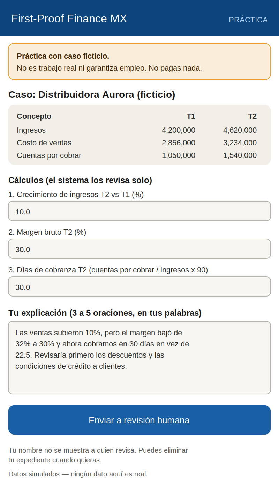
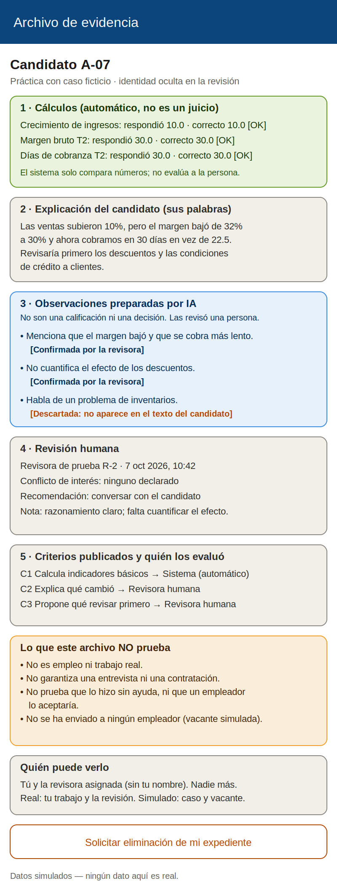
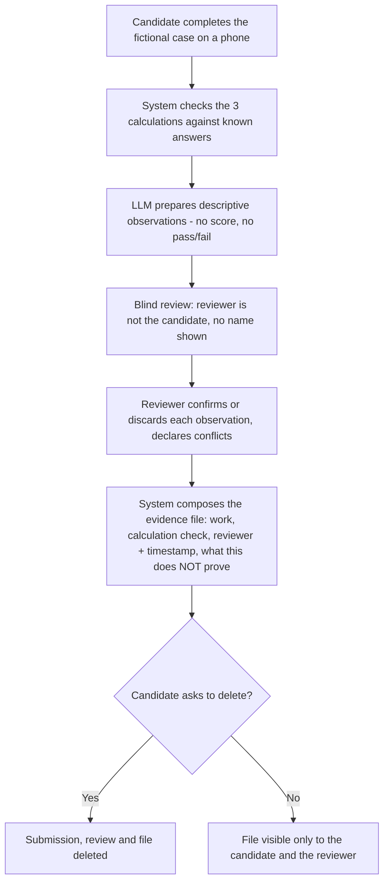
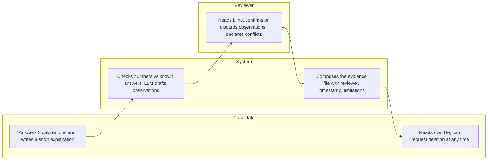

# PACKET — Business Bending, Week 9
**Gonzalo Patlán · Role: USER · Blueprint declaration: candidate evidence file showing work, explanation, reviewer and limitations; honoring Conditions 1 and 4**

## Problem, in my words
My Brain Bending research left me with one verifiable voice: Miguel, 27, a Business Administration graduate delivering food through an app, who told La Jornada in 2022 that applications ask "qué experiencia tengo." It also left me with a correction: the broad claim that "the problem is the proof" lost to the evidence, because weak entry-level demand and a mismatch between training and the market explain much of it, and a better file cannot create vacancies (Elisa's dissent in our Blueprint). What survives is a narrow test our team accepted: whether a short, human-reviewed work sample helps a junior finance applicant without formal experience get read. My slice builds the document at the center of that test, an evidence file that shows the work, the explanation, who reviewed it and what the review does not prove.

## Exact user
A junior finance applicant, roughly 22 to 27, with a degree and no formal experience, using a phone. They have sent many applications and keep being asked for experience they cannot show. A second actor is the human reviewer, who is never the candidate.

## Success definition
Before the module closes: a candidate on a phone can complete a fictional financial case in under 15 minutes; a different account, blind to the candidate's identity, reviews it; and the system produces an evidence file showing the work, the automatic calculation check, the candidate's explanation, AI-prepared observations marked as such and confirmed or discarded by the reviewer, the reviewer's identity, timestamp and conflict declaration, and a plain list of what the file does not prove. The candidate can delete everything at any time.

## Mockup
**Screen 1: candidate completes the fictional case (phone layout)**

{ width=45% }

**Screen 2: the evidence file**

{ width=45% }

## Flow: flowchart

## Flow: swimlane (who does what)

## Benchmark: GLOBAL to LOCAL
The best existing solution on Earth for this is **Applied**, a UK hiring platform born inside the Behavioural Insights Team: candidates answer work-sample questions, responses are anonymised and split by question, and three reviewers read them independently. In the team's own validation, scores from the Applied sift correlated positively and significantly with later assessment-centre and interview scores (reported by the vendor, from a graduate round with 700+ applicants, so not an outside evaluation).

Mine differs or localizes in four ways. Applied serves an employer who already has a vacancy and ranks candidates by aggregated scores; my file has no ranking and no AI score, because our Blueprint forbids presenting simulated activity as employment and forbids AI rejecting anyone. It is in Spanish, short and usable on a phone, and free for the candidate. And it states plainly what it does not prove, since I found no Mexican evidence that employers accept a third-party proof at all.

## Long view (3 years)
If this slice works, the evidence file becomes the first thing an employer reader opens for a junior finance vacancy: the same short case, published criteria and a named human reviewer, instead of a CV. Across pilots, the criteria and the review records could show whether reviewed work changes who gets interviewed, which is exactly the question Elisa's dissent leaves open. At that point the product is not a platform of badges but a small, auditable handoff between a candidate and an employer who has a real vacancy.

## Scope cut: what I am NOT building
- The employer-facing financial-case demo, the full AI-assisted review design and the reconsideration flow (Valeria's and Elisa's slices). The AI observations here are a minimal version so the file can show them, clearly labeled.
- The full submission and review record with signatures and timestamp architecture (Andrea's slice). Here the reviewer is a name plus a timestamp.
- Blockchain or any "immutable" record. The Blueprint defers it because an immutable record cannot establish capability.
- Any real vacancy, employer, interview promise, payment, ranking or score.
- Candidates from the informal economy, which is outside this pilot's reach.

## Blueprint conditions: how this slice honors them
- **Condition 1 (shadow clause):** the case is fictional and labeled as practice on every screen; the file states it is not employment, not a hiring guarantee, and has not been sent to any employer.
- **Condition 3:** the AI only prepares descriptive observations; it cannot score, pass or reject, and a human confirms or discards each one.
- **Condition 4:** published criteria; calculations (automatic) are shown separately from judgments (human); the reviewer sees no name, school or work history; the reviewer is never the candidate and declares conflicts.
- **Condition 5:** short, plain Spanish, phone layout; the file shows what is real and what is simulated, who can see it, and lets the candidate delete everything.

## Architecture + stack

| Layer | Choice | Notes |
|---|---|---|
| Frontend | Next.js on Vercel | Phone-first: candidate screen, review screen, evidence file |
| Auth | Supabase Auth, Google sign-in | Candidate and reviewer are just different signed-in users in the same pilot organization |
| Database | Supabase Postgres | `orgs`, `profiles`, `submissions`, `reviews` (reuse the org + join-code pattern from earlier weeks) |
| Row Level Security | ON | Candidates see only their own rows; reviewers read submissions only through a function that returns blind fields (no name, no candidate id) |
| Structured / verified data | Fictional case with known answers | The three calculations are computed by code, never by the LLM |
| Matching logic | Criteria-to-evidence map | Each published criterion is linked to the evidence that supports it and to who judged it (system or human) |
| LLM | Claude Haiku 4.5, server-side | Prepares descriptive observations only; guard rejects scores, hiring or employment language, and invented numbers |
| Integrity rules | Database trigger + server check | A reviewer cannot be the candidate; deleting a submission deletes its review and file |
| Secrets | Vercel environment variables | No keys in the repo |
| Seed data | Invented case, invented users | No real personal data; everything labeled "Datos simulados" |

## Test plan

**Mechanical pass:** submit correct and incorrect calculation answers and confirm the automatic check matches hand calculation (10.0 / 30.0 / 30.0); generate observations many times and confirm none contains a score, pass/fail, hiring or employment claim, or a number not in the case; confirm the candidate cannot review their own submission (server and database); confirm the reviewer view shows no name; confirm a second organization sees nothing; confirm deletion removes the submission, review and file; confirm the "what this does NOT prove" block always appears. Find and fix at least one bug, redeploy. Before delivery, confirm Vercel Deployment Protection is off and the URL loads in an incognito window.

**Persona test (Layer 1):** persona is a 25-year-old Accounting graduate who delivers food by app, has applied dozens of times, has done online tests that never got a reply, and distrusts any platform that promises jobs. Walk them through the candidate screen and the evidence file by screenshots, in order, narrating where they hesitate, whether they believe the file, and whether "what this does NOT prove" reads as honesty or as a reason to walk away. Log every confusion and fix the worst one.
