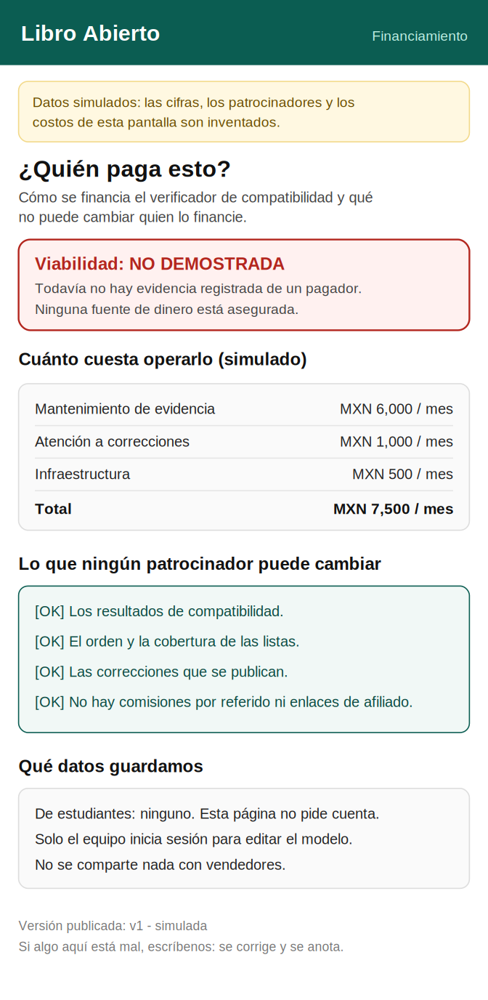
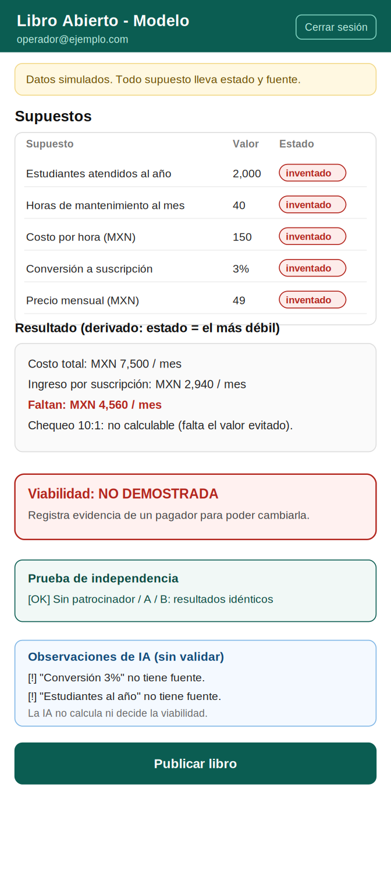
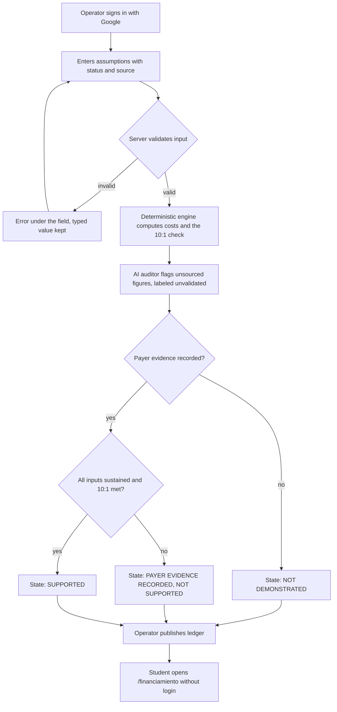
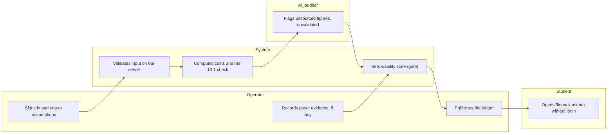

# PACKET - Week 10 - Libro Abierto

Gonzalo Patlan - Role: MONEY - Team 8 - Primary vacuum: Regret Prevention (independent laptop-compatibility verification for Mexican university students)
My declaration (Blueprint): build a unit-economics and independent-funding feasibility model. Honors **Condition 5, Independent governance**.

> All figures, sponsors and costs in this packet and in the app are invented and labeled as such.

## 1. Problem in my words

My team will publish a "verified" label on laptop-compatibility claims. A verified label carries authority. If the money behind it quietly shapes the results, or if nobody can see who pays and what it costs, the label misleads a student who is about to spend a large amount of money.

My Brain Bending found that no payer closes the 10:1 for this kind of product with evidence. So my job is not to rescue the business model. It is to make funding and cost **visible and testable**, to refuse to say "viable" without evidence of a payer, and to prove that who pays cannot change the result.

## 2. Exact user

A Mexican university student who sees a "verified" label before buying a laptop and wonders: *who pays for this, and can they change what it tells me?* They do not log in and they should not have to.

Secondary user: the team operator (me, MONEY), who logs in with Google to edit assumptions and publish the ledger.

I have not built a user persona for this week from interviews. The persona for the test will be built from David's USER research and will not be invented here.

## 3. Success definition

Before the module closes, all of this works at the live URL:

1. A student opens `/financiamiento` with no account and sees: how the verifier is funded, each operating-cost line, what no sponsor can change, and what data is kept.
2. The operator signs in with Google and edits assumptions. Every assumption carries a status (**sustained**, **weak**, **invented**) and a source, and any derived figure takes the status of its weakest input.
3. The viability state reads **NOT DEMONSTRATED** unless a payer-evidence record exists. This is enforced by the server and the database, not only the screen.
4. An automated test shows the model's output is identical for sponsor A, sponsor B and no sponsor.
5. An AI auditor flags unsourced figures, labeled as unvalidated. It does not calculate and does not decide viability.

## 4. Mockup (2 screens)

**Screen 1 - what the student sees** (`assets/w10-mockup-public.png`)

{ width=45% }

**Screen 2 - what the operator sees** (`assets/w10-mockup-operator.png`)

{ width=45% }

## 5. Flow

### Flowchart

### Swimlane

(Image version for the PDF: `assets/w10-swimlane.png`.)

## 6. Benchmark (global to local)

- **Best existing solution on Earth for this is:** Which? (UK). It states it is a not-for-profit charity, takes no advertising or sponsorship, and is funded by member subscriptions, by consumers who transact with it, and by the products and services its experts endorse (Which?, "Our statement of editorial independence"). Its own funding page notes it also charges traders for its Trusted Traders scheme. A third-party description says it also earns retailer commissions; I have not verified that.
- **Mine differs or localizes by:** making the funding and cost model itself a public, testable artifact (a viability gate and a sponsor-independence test), forbidding every referral income including endorsement or commission revenue (Condition 5), and not assuming that Mexican students will pay a subscription, because I have no evidence of a payer.

## 7. Long view (3 years)

If this slice works, the ledger becomes the public funding-and-cost disclosure attached to every verification claim the compatibility checker publishes. A funder (a university or a student cooperative, for example) could sponsor coverage without choosing outcomes, because outputs are tested to be sponsor-independent. In three years either a real payer is documented and the ledger shows its true cost per student, or the ledger says publicly that the model is not viable, which is also a valid result.

## 8. Scope cut (what I am NOT building)

- The compatibility checker itself (Emilio), the student requirements checklist (David), the correction workflow (Sofia), the coverage audit (Hana).
- Payments, subscriptions, real sponsors, or any real money flow.
- Referral links, affiliate links, product recommendations, a store, or a recommendation engine for sellers.
- Any real student data. Students never create an account.
- An AI that calculates, ranks or decides viability.

## 9. Architecture and stack

| Layer | Choice | Why |
|---|---|---|
| App | Next.js (App Router, TypeScript) on Vercel | Same pattern as previous weeks; free tier |
| Data and auth | Supabase Postgres + Auth with Google | Security floor: auth for anything personal |
| Access control | Row Level Security on every table, helper `my_org_id()` (`security definer`), `revoke execute ... from public, anon` | Lessons from Week 6 |
| Model | `lib/modelo.ts`, pure deterministic functions | The AI never calculates or decides |
| Public data | `published_ledger` table, anonymous read-only, no personal data | Student sees it without login |
| AI auditor | LLM called from the server only; key in Vercel environment variables | Flags unsourced figures |
| Guard | Server rejects AI output that contains new numbers, verdict words or alliance language | The page, not the model, applies the "unvalidated" label |
| Tests | `npm run test:logica`, `npm run test:schema` | Same as Week 9 |

**Dragon Stack, honestly:** LLM (auditor) + constraint data (the assumptions registry and the independence rules) + a deterministic calculation and gate engine. Condition 4 forbids extra technology without a measured benefit, so I test the LLM against a plain rule-based check (status field empty or source missing) on identical seeded assumptions with planted errors. If the LLM finds nothing the plain check misses, I report that and keep it labeled as optional.

## 10. Test plan

**Mechanical pass** (find at least one real bug, fix, redeploy):

1. Sponsor independence: same inputs with sponsor A, B and none give identical outputs.
2. Viability gate: no payer evidence means the state can never read SUPPORTED, from the UI, the server, or a direct database call.
3. Status inheritance: a derived figure takes the status of its weakest input; an invented input can never produce a "sustained" figure.
4. Input validation on every form: type, range and length; rejects NaN, `1e3`, Infinity and thousands separators; decimal comma accepted.
5. No referral fields: no column or code path named commission, affiliate or referral exists.
6. Data page matches reality: the list of stored data on the public page equals the tables and columns that actually exist.
7. RLS: a user sees only their organization's rows; anonymous users can only read `published_ledger`; direct calls to the functions fail for `anon`.
8. AI guard: output containing a number not in the input, or verdict words, is rejected.
9. Incomplete and empty states: no assumptions, a missing source, zero students, no payer: the page says "not calculable" instead of inventing a value.

**Persona test (Layer 1):** a synthetic student built from David's USER research walks the public page from screenshots, narrates where they doubt, and I fix the worst confusion. Documented in `PERSONA_GonzaloPatlan_Week10.pdf`.

**Condition 5 mapping:** sponsor-independent outputs (test 1), data-handling review (test 6), full operating costs documented (cost lines on both screens), payer evidence required before any viability claim (test 2).
