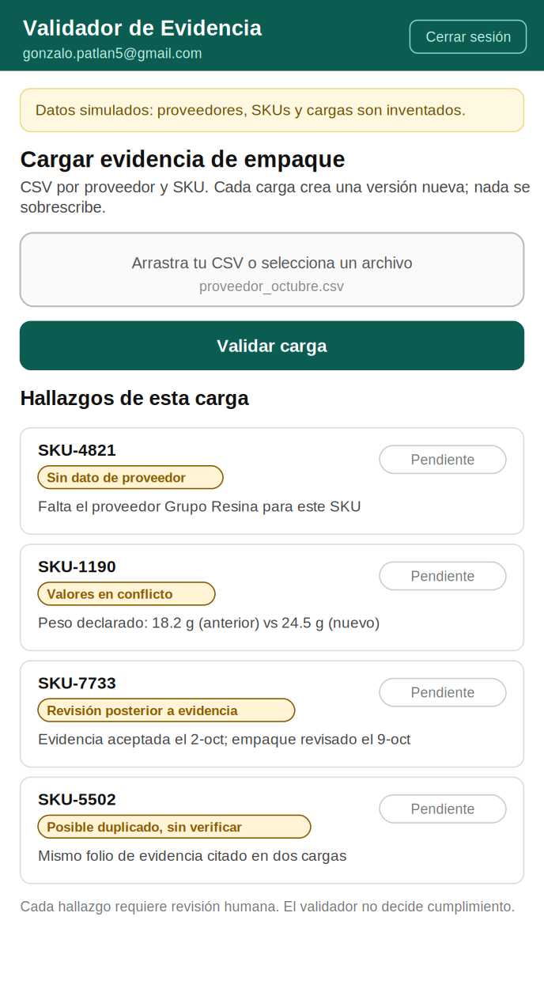
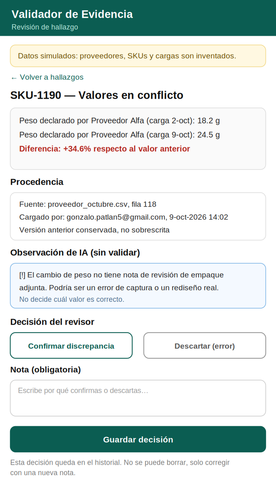
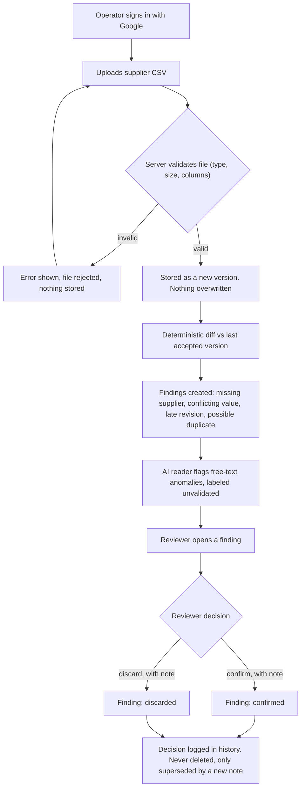
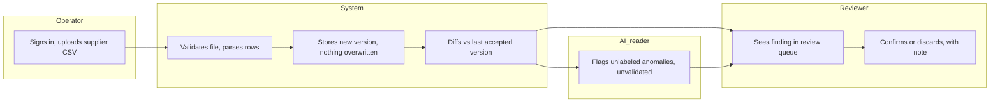

# PACKET - Week 11 - Packaging Evidence Validator

Gonzalo Patlan - Role: TECHNOLOGIST - Team 8 - Primary vacuum: EPR-compliance (Packaging Evidence Diagnostic for Mexican producers and importers)
My declaration (Blueprint): build a Packaging Evidence Validator that detects missing supplier data, conflicting values and packaging revisions, with provenance and human review. Honors **Condition 3, Evidence integrity**.

> All suppliers, SKUs and uploaded files in this packet and in the app are invented and labeled as such.

## 1. Problem in my words

My team's product will tell a producer whether their packaging-evidence file is reconciled enough to support an EPR claim. If the validator quietly accepts a file with missing suppliers, contradicting weights, or the same proof cited twice, the evidence it approves is worthless, and worse, it looks authoritative.

My job is not to decide whether a company complies. It is to make every gap, contradiction and possible duplicate **visible and traceable**, keep every past version, and never let an AI suggestion become a decision without a person approving it.

## 2. Exact user

The internal reviewer at a packaging team (or at my teammates' compliance tool) who has to look at a pile of supplier CSVs before a reconciliation cycle closes, and currently does that by eye in a spreadsheet.

Secondary user: the operator who uploads the file (also me, TECHNOLOGIST, standing in for whoever runs this at a company).

I have not built this persona from Hana's USER research. The persona for the test will be built from her Packaging Evidence Burden Check and will not be invented here.

## 3. Success definition

Before the module closes, all of this works at the live URL:

1. An operator signs in with Google, uploads a supplier CSV, and the file becomes a new, immutable version. Nothing already stored is overwritten.
2. The validator detects, deterministically: a SKU missing from a provider's file, the same SKU with two different weight or material values across versions, and a packaging revision dated after the last accepted evidence.
3. Every finding starts as **pending** and can only change state (confirmed / discarded) through a human decision with a required note. No automatic resolution exists.
4. The same provenance (source file, row, uploader, timestamp) is attached to every value and survives every new version.
5. An AI reader may flag anomalies in free text, labeled **"sin validar"**, but it never calculates a value, never says a finding is resolved, and never produces a recycling, recovery or compliance claim. The server blocks any AI output that contains a verdict word.
6. If the same evidence reference (folio) appears in two uploads, the system labels it "possible duplicate, unverified" — never "verified recovery."

## 4. Mockup (2 screens)

**Screen 1 - operator: upload and findings list** (`assets/w11-mockup-validador.png`)

{ width=45% }

**Screen 2 - reviewer: one finding, decision and note** (`assets/w11-mockup-revision.png`)

{ width=45% }

## 5. Flow

### Flowchart

### Swimlane

(Image version for the PDF: `assets/w11-swimlane.png`.)

## 6. Benchmark (global to local)

- **Best existing solution on Earth for this is:** Recyda, Specright and Lorax, which already offer packaging-data capture and EPR reporting capabilities (named in our Blueprint). They manage the data pipeline end to end, including filing.
- **Mine differs or localizes by:** not trying to replace that pipeline or file anything. It is a narrower, auditable reconciliation layer that only surfaces discrepancies with provenance and forces human sign-off, for a market (Mexico's new producer-responsibility law) where the Blueprint found no proven recurring demand yet. I am not assuming this beats the incumbents; Condition 1 requires comparing against them and against a spreadsheet before claiming additional value, which is David's (MONEY) job, not mine.

## 7. Long view (3 years)

If this slice works, the validator becomes the evidence layer underneath my team's EPR-compliance product: every supplier claim a producer submits carries its source, its version history, and a human decision trail, and no AI-generated text can become a compliance claim without a person approving it. In three years either real producers pay for this reconciliation discipline because it survives an audit, or the team learns, as MONEY's Blueprint dissent already suspects, that this is not a recurring paid need and the evidence says so honestly.

## 8. Scope cut (what I am NOT building)

- The commercial viability comparator against existing vendors and spreadsheets (David, MONEY).
- The two-cycle reconciliation workflow with imports, exceptions and approvals across a full compliance cycle (Emilio, OPERATOR).
- The burden check identifying who does the extra documentation work (Hana, USER).
- The shadow guard against unsupported recycling claims and informal-collector exclusion (Sofia, ADVERSARY) — though my validator's own duplicate-flagging and "no verdict" rule are built so they do not need that guard to stay honest.
- Any real supplier, producer or packaging data. Everything is invented and labeled.
- Any claim of recycling, environmental recovery, or legal compliance, anywhere in the product.
- Anything about pepenadores or informal collectors (the backup vacuum, not mine).

## 9. Architecture and stack

| Layer | Choice | Why |
|---|---|---|
| App | Next.js (App Router, TypeScript) on Vercel | Same pattern as previous weeks; free tier |
| Data and auth | Supabase Postgres + Auth with Google | Security floor: auth for anything personal |
| Access control | Row Level Security on every table, helper `my_org_id()` (`security definer`), `revoke execute ... from public, anon` | Lessons from Week 6 and Week 9 |
| Evidence store | `evidence_versions` table: append-only, every upload is a new row, never updated or deleted | Condition 3: preserve sources and version history |
| Findings engine | `lib/validador.ts`, pure deterministic functions: missing supplier, value conflict, late revision, duplicate folio | The AI never decides a finding |
| AI reader | LLM called from the server only; key in Vercel environment variables | Flags free-text anomalies, labeled unvalidated |
| Guard | Server rejects AI output containing verdict words (cumple, reciclado, recuperado, verificado) or a number not present in the input | The page, not the model, applies the "sin validar" label and decides nothing |
| Review log | `decisions` table: append-only, one row per decision, never edited | A later correction is a new row, not an edit |
| Tests | `npm run test:logica`, `npm run test:schema` | Same as previous weeks |

**Dragon Stack, honestly:** IoT/sensing is simulated here (a supplier CSV upload stands in for sensed packaging data, labeled as simulated, since this vacuum is paperwork, not a physical sensor) + ML (the AI reader) + a third layer: deterministic diff/validation logic against the version history, which is the part Condition 3 actually depends on.

## 10. Test plan

**Mechanical pass** (find at least one real bug, fix, redeploy):

1. Upload a CSV missing a known supplier row: the "missing supplier" finding appears, with the exact SKU.
2. Upload a second version changing one SKU's weight: a "conflicting value" finding appears showing both values, both provenances, and neither is auto-resolved.
3. Upload a CSV whose packaging-revision date is after the last accepted evidence date: the "late revision" finding appears.
4. Upload a CSV reusing a folio already used in a previous upload: "possible duplicate, unverified" appears — never "verified."
5. Try to confirm or discard a finding with no note: rejected by the server.
6. Confirm a finding, then try to edit that decision: it cannot be edited, only superseded by a new decision row, and both remain visible.
7. AI guard: any AI output containing a verdict word, or a number not present in the input data, is rejected and never reaches the screen.
8. Input validation: file type and size limits; malformed CSV rows are reported per row, not silently dropped.
9. RLS: a user sees only their organization's evidence and findings; `anon` cannot read any table.
10. Re-upload the same unchanged file: no new findings are created, and the system says so.

**Persona test (Layer 1):** a synthetic reviewer built from Hana's (USER) Packaging Evidence Burden Check research walks the two screens from screenshots, narrates where they doubt, and I fix the worst confusion. Documented in `PERSONA_GonzaloPatlan_Week11.pdf`.

**Condition 3 mapping:** provenance on every value (tests 1-2), version history never overwritten (test 6), missing/conflicting data flagged (tests 1-2-3), AI suggestions require human approval and cannot stand alone (test 7).
