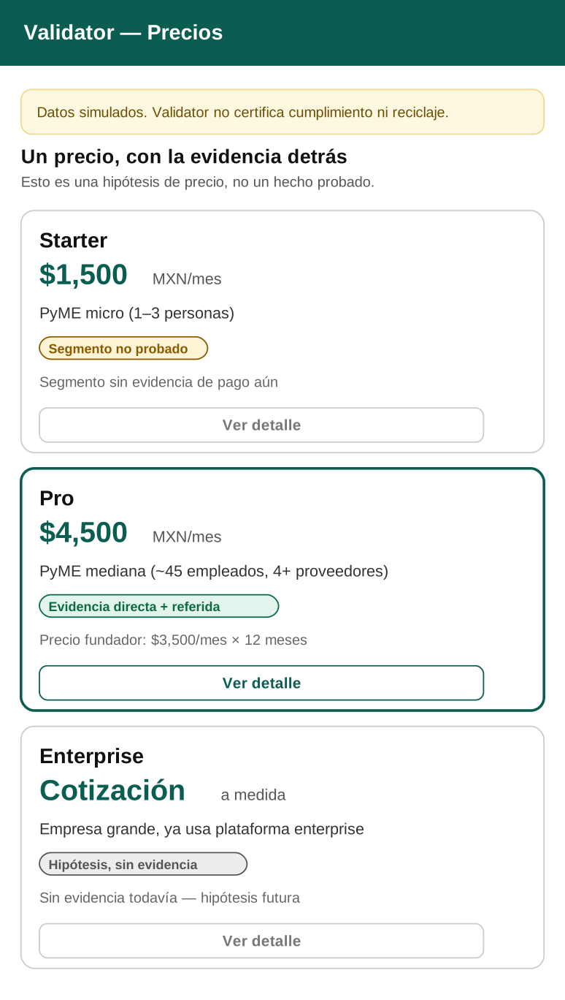
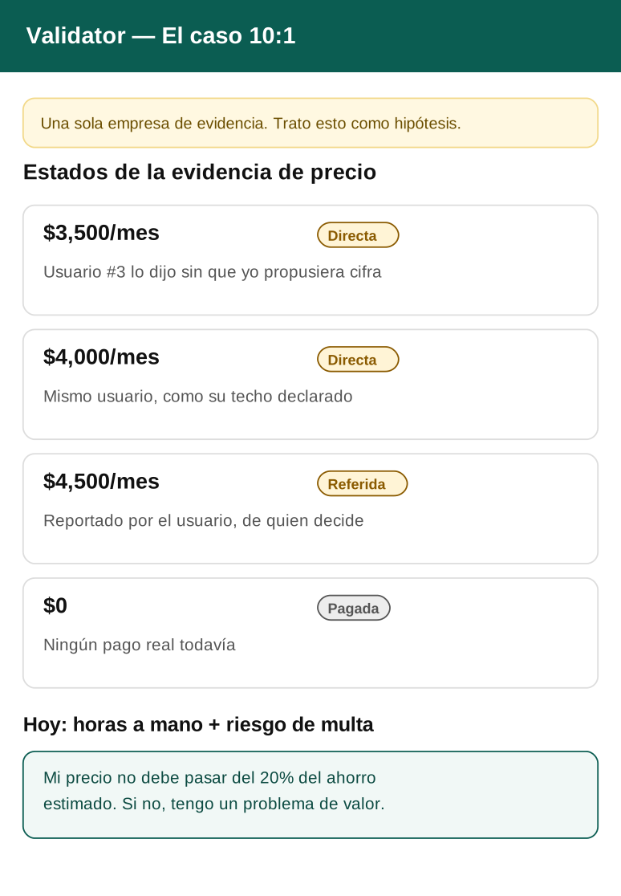
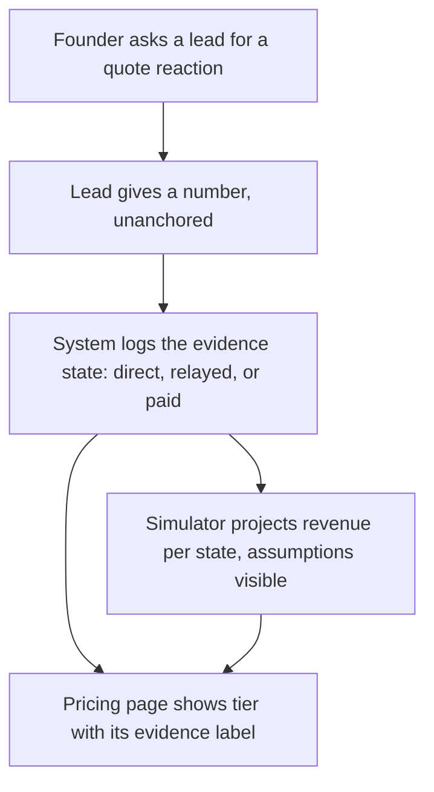
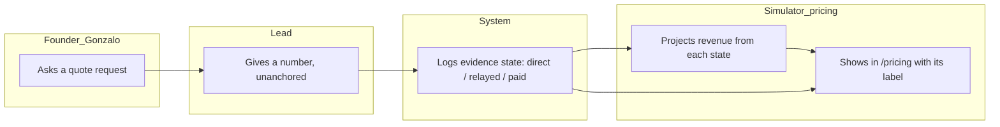

# PACKET - Week 14 - Validator (Pricing)

Gonzalo Patlan - Venture: Validator - packvalidator.online
Declaration (BLUEPRINT_14_team_8.pdf, Condition #2): "Build Validator's pricing view with direct, relayed and paid evidence states." Honors Conditions 1, 2, 3, 4 and the Shadow Clause (5).

> All suppliers, SKUs and uploaded files remain invented and labeled. Pricing evidence (amounts, who said them) is real, from my own Week 13/14 user sessions, and is labeled by its evidence state - not presented as a completed sale.

## 1. Problem in my words

My venture had a price-shaped hole: no public /pricing page, no 10:1 memo, and - this is the real problem this week - three different price numbers from the same user ($3,500 unanchored, $4,000 his stated ceiling, $4,500 relayed from his company's actual decision-maker), with zero real payments. If I publish one of those numbers as if it were "the price, validated," I'd be doing exactly what the shadow clause of this week's chapter warns against: letting evidence quietly upgrade itself. The fix is a pricing view that keeps each number labeled by how strong it actually is.

## 2. Exact user

Same as prior weeks, refined by this week's evidence: the Pro tier targets a mid-size producer (~45 employees, 4+ packaging suppliers) - the only segment with real pricing evidence so far. The micro-SME (1-3 people, my original Charter description, e.g. Concept G) is kept as a lower, unproven tier, not discarded.

## 3. Success definition

Before the module closes, all of this works at packvalidator.online:

1. `/pricing` is live with 3 tiers (Starter, Pro, Enterprise) and 2 customer segments, each tier showing its real evidence state (unproven / direct+relayed evidence / no evidence - hypothesis).
2. A revenue simulator: inputs (number of direct leads, conversion rate lead→relayed, conversion rate relayed→paid, price per tier) produce monthly/annual revenue, with every assumption labeled and editable.
3. `/about` carries the 10:1 memo: what the user does today (manual reconciliation, no platform), its true cost (time + risk), my price, and the three evidence-state numbers side by side, never averaged or picked as one.
4. The founder-price discount ($3,500/mo for 12 months) is shown next to, never instead of, the list price ($4,500/mo), so the public price is never anchored to one person's number.

## 4. Mockups (2 screens)

**`/pricing`** (`assets/w14-mockup-pricing.png`): 3 tiers, Pro highlighted as the only one with real evidence.

{ width=40% }

**`/about`, 10:1 memo** (`assets/w14-mockup-about.png`): the three evidence states plus the $0-paid line, shown honestly.

{ width=40% }

## 5. Flow

### Flowchart

### Swimlane

(Image version for the PDF: `assets/w14-swimlane.png`. Shadow clause: payment buys access or service, never a better evidence label - the source stays visible at every step.)

## 6. Benchmark (global to local)

- **Best existing solution on Earth for this is:** Vanta and Drata, SOC 2 compliance platforms - both quote-only, with no public list price, observed ranges from ~US$6,500-12,000/year (small teams) to US$80,000-100,000+/year with multiple frameworks (sources: Vendr, SOC2 Auditors, ERPResearch, 2026).
- **Mine differs or localizes by:** publishing a real list price instead of quote-only, because my buyer isn't losing sales for non-compliance like a SOC 2 customer is - they're avoiding a fine that may never arrive, so hiding the price behind a sales call would only add friction to an already weak willingness to pay.

## 7. Long view (3 years)

If this pricing view holds, Validator's three evidence states become the backbone of how the whole venture reports progress - not "X customers," but "X direct signals, Y relayed, Z actually paid" - so neither I nor an investor can mistake enthusiasm for revenue. In three years, either the mid-size-SME segment converts real payments at this price, or the evidence says so honestly and the price moves.

## 8. Scope cut (what I am NOT building)

- No real payment processing this week - "paid" evidence state exists in the schema and UI but is simulated/labeled, pending a real pilot charge.
- No enterprise-tier features - Enterprise stays a "request a quote" hypothesis, not a built offering.
- No automatic price changes based on the simulator - the founder reviews and decides, per Condition 2.
- Any claim of compliance, recycling, or environmental recovery - unchanged shadow clause from Weeks 12-13.

## 9. Architecture and stack

| Layer | Choice | Why |
|---|---|---|
| App | Next.js on Vercel, existing w12-validator project | Iteration, same venture |
| Pricing data | `pricing_evidence` table: amount, state (direct/relayed/paid), source, date - append-only | Condition 2: log each signal separately, never overwrite |
| Simulator | Client-side calculator, assumptions as editable inputs, saved scenarios per Stack Floor | "Working calculator logic with saved scenarios" |
| /pricing, /about | Public pages, no login required | A price without a public page is a secret, not a price |
| Tests | `npm run test:logica`, `npm run test:schema` | Same pattern as previous weeks |

## 10. Test plan

**Mechanical pass:**
1. Add a new evidence entry (direct/relayed/paid) - confirm it appears on the correct tier with its label, never silently upgraded to "paid" without a real transaction flag.
2. Run the simulator with the founder's conversion assumptions - confirm monthly/annual output matches manual arithmetic.
3. Save a scenario, reload the page - confirm it persists.
4. Confirm `/pricing` and `/about` load without a session (public pages).

**Persona test (Layer 1):** both personas (Gonzalo/Concept G, Renata/synthetic) walk `/pricing` and `/about` from screenshots, checking whether the evidence-state labels read as honest disclosure or as confusing jargon to a first-time visitor.
