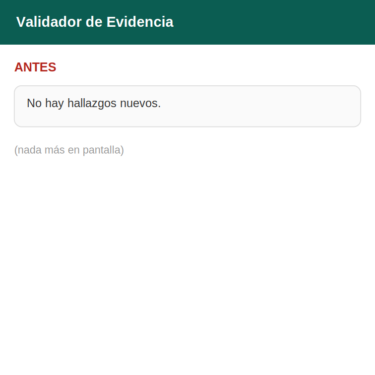
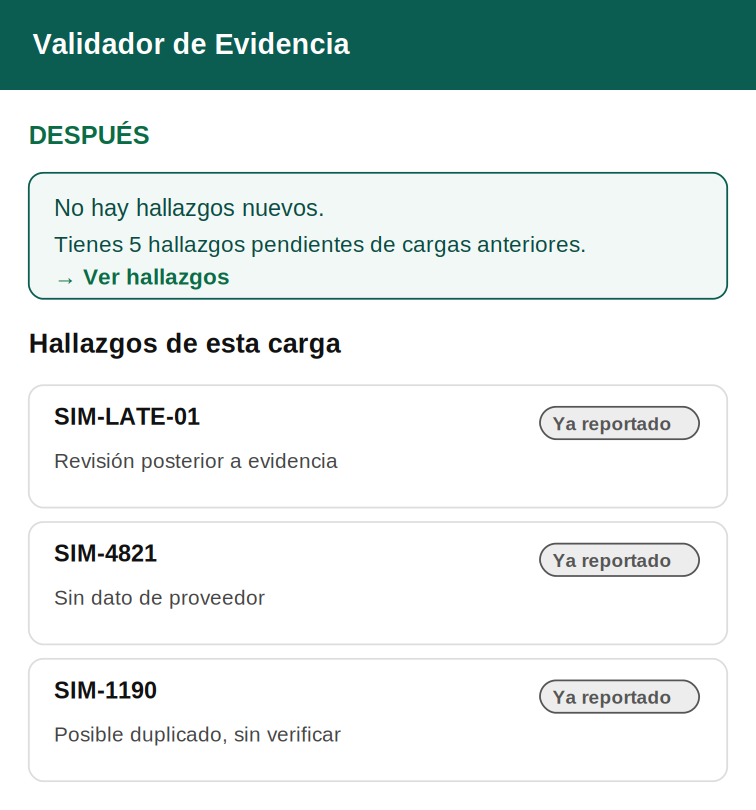
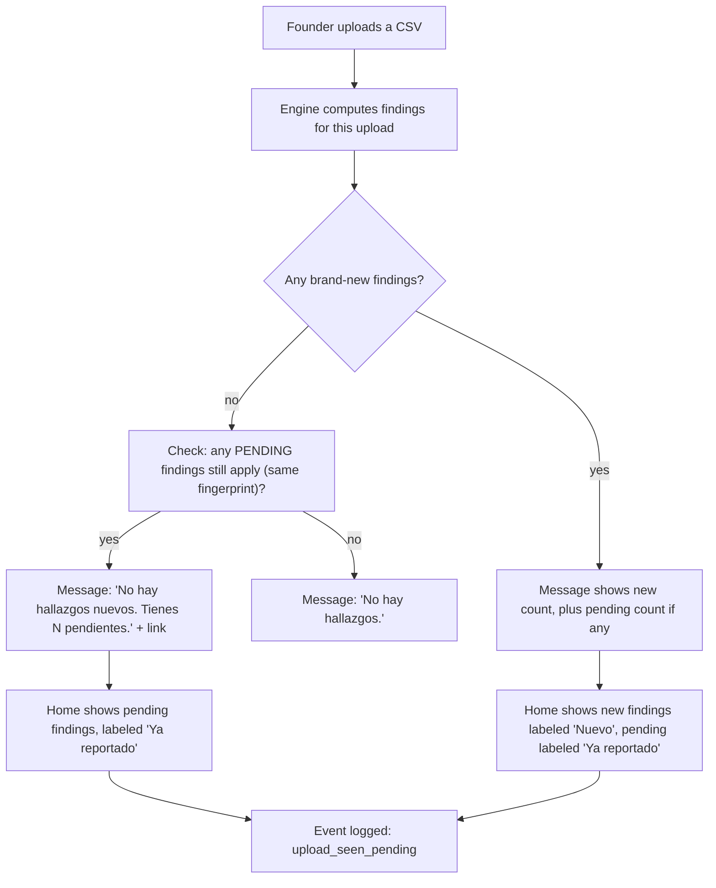
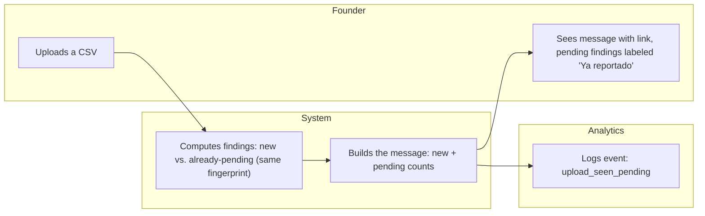

# PACKET - Week 13 - Validator (Real Humans)

Gonzalo Patlan - Venture: Validator - packvalidator.online
This is an iteration, not a new product: the problem below is reframed by five real-user sessions (Layer 2 testing), not researched from a library. Aligned with CHARTER.md, PERSONAS.md and BLUEPRINT_W12_Team8.pdf (conditions still in force for Weeks 12-17).

## 1. Problem in my words

Five real users (3 strangers, 1 referral, 1 known - documented in REAL_USERS_REPORT_GonzaloPatlan_Week13.pdf) confirmed something I hadn't measured: when a new upload only repeats issues already pending (fingerprint-deduplicated, including an identical re-upload), the home screen said "No hay hallazgos nuevos" and showed zero cards - even when real, unresolved findings existed. Two users named this confusion directly ("me costo encontrar el hallazgo especifico", "un poco confuso el saber que documento subir" on an adjacent screen); a Playwright measurement confirmed it reproducibly in production. A founder reading a "no issues" message when 5 issues are actually pending is the opposite of what Validator exists to prevent.

## 2. Exact user

Same two personas as Week 12 (PERSONAS.md): Gonzalo (Concept G) and Renata (synthetic, cosmetics). This week adds real evidence from a third profile outside both: a delivery lead at an unnamed SME, cold-contacted, in-ICP, who is the user who reported and later confirmed the fix (REAL_USERS_REPORT, section 5).

## 3. Success definition

Before the module closes, all of this works at packvalidator.online (already shipped and verified in production - see DECISIONS.md, commits 1977b78 and 7ef9e76):

1. When a carga produces no new findings but pending findings from earlier cargas still apply, the home screen shows them, labeled "Ya reportado", instead of implying nothing is wrong.
2. The message states the real count of pending findings and links directly to them ("Ver hallazgos").
3. The worst-readability finding text ("Sin dato de proveedor") is rewritten in plain language, measured before/after with the same method (Fernandez-Huerta: card 41.0 -> 66.9, detail 33.7 -> 77.4).
4. A simple event log records when a user sees a "pending findings" message, as the stack-floor addition for this week.

## 4. Mockup (2 screens)

**Before** (`assets/w13-mockup-antes.png`): the misleading message, in production until this week's fix.

{ width=40% }

**After** (`assets/w13-mockup-despues.png`): what real users now see, verified in production.

{ width=40% }

## 5. Flow

### Flowchart

### Swimlane

(Image version for the PDF: `assets/w13-swimlane.png`. The founder is both uploader and reviewer this week, per the Charter's single-founder limit.)

## 6. Benchmark (global to local)

- **Best existing solution on Earth for this is:** Sentry's issue grouping and embedded User Feedback widget - it groups repeated events into one issue instead of re-alerting, and collects in-context feedback tagged for triage.
- **Mine differs or localizes by:** Sentry's grouping hides repetition from the user entirely (by design, for engineers who don't want noise); Validator's users explicitly told us the opposite problem - they needed repetition to stay *visible*, labeled, not hidden, because the audience is a non-technical founder who needs to know unresolved work still exists, not an engineer triaging alert volume.

## 7. Long view (3 years)

If this slice holds, Validator's event log becomes the backbone of a real usage-pattern dataset: which finding types get ignored longest, which messages get clicked, which users return after a specific fix - informing both the product and, eventually, a defensible answer to the still-unverified willingness-to-pay question (Brief, Week 13, section 4) that user interviews alone can't settle.

## 8. Scope cut (what I am NOT building)

- The mobile label-alignment and small-touch-target issues found this week (documented in DECISIONS.md, not fixed - low severity, mobile-only).
- Any price validation experiment (the #1 real threat per this week's Brief) - deliberately deferred to next week, not hidden.
- Multi-person review workflows (Blueprint Condition 2, unchanged).
- Any EPR filing, compliance certification, or recycling claim (shadow clause, unchanged).

## 9. Architecture and stack

| Layer | Choice | Why |
|---|---|---|
| App | Next.js on Vercel, existing w12-validator project | Iteration, not a new app |
| Findings engine | `lib/validador.ts`, extended with `pendientesQueAplican()` | Reuses the existing fingerprint/dedup logic; no new engine |
| Event log (new this week) | Minimal table, append-only, one row per message shown | Stack-floor requirement: analytics/feedback mechanism |
| Tests | `npm run test:logica` (201/201, +7 cases), `npm run test:schema` (191/191) | Same as previous weeks |

## 10. Test plan

**Mechanical pass, already run and documented (DECISIONS.md):**
1. Upload a CSV whose issues are all already pending: home shows them labeled "Ya reportado", with the correct count in the message. Verified in production (before: 0 cards; after: 5 cards).
2. Upload a CSV with one genuinely new issue plus pending ones: both labels ("Nuevo" and "Ya reportado") appear correctly, counts match.
3. Mobile (375px): no horizontal scroll, labels stay inside their card. Two minor issues found and logged as not-fixed-this-week (label shifts 4px on line wrap; link touch target is 20px, below recommended minimum).
4. Readability before/after on the worst-scoring finding text, same method, same real data.

**Persona test (Layer 1):** still pending this week - to be run on the updated screens with Gonzalo and Renata personas (PERSONAS.md).

**Real humans (Layer 2), already complete:** 5 sessions, pain ranked and argued with the model, pain #1 fixed and verified in production, one user confirmed he would return after the fix - full detail in REAL_USERS_REPORT_GonzaloPatlan_Week13.pdf and BUILDCHAT_GonzaloPatlan_Week13.pdf.
