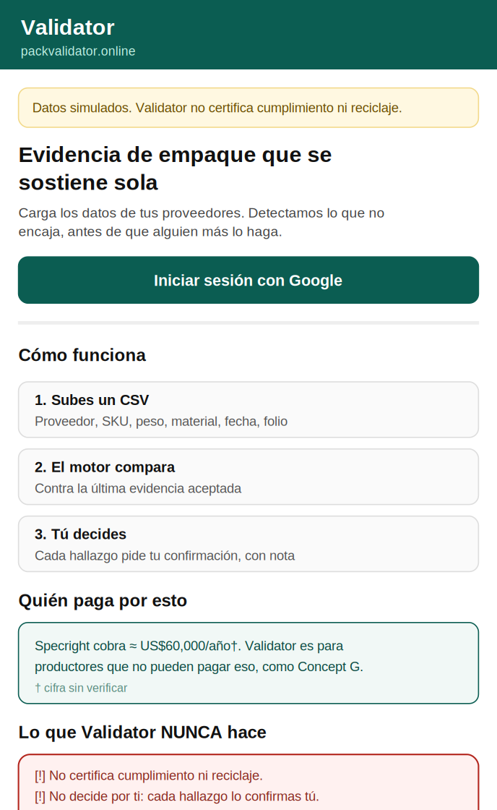
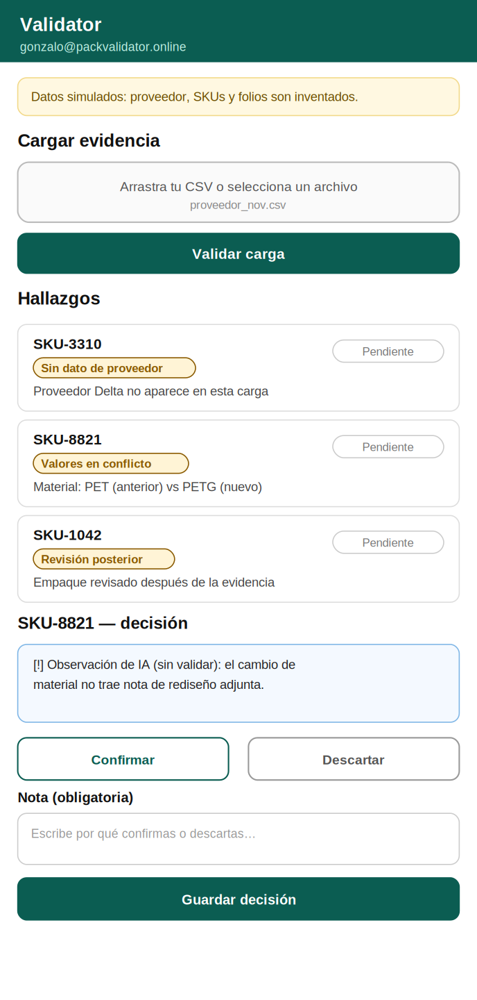
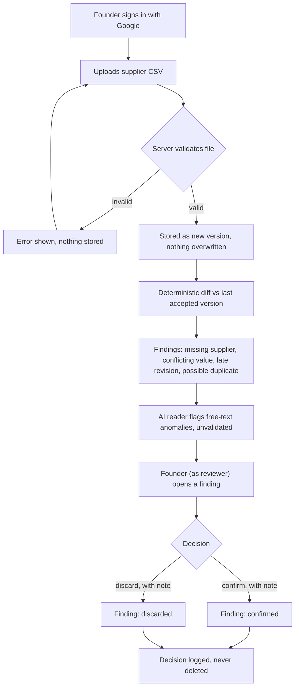
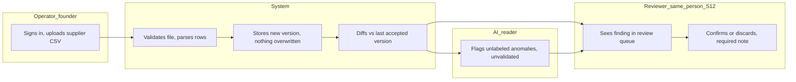

# PACKET - Week 12 - Validator (Core Build)

Gonzalo Patlan - Venture: Validator - packvalidator.online
Written before the rebuild starts, aligned with docs/CHARTER.md, docs/PERSONAS.md, and the conditions in BLUEPRINT_GonzaloPatlan_Week12.pdf (individual Team Bending, team did not respond - see that document's note).

> All suppliers, SKUs and uploaded files in this packet and in the app are invented and labeled as such.

## 1. Problem in my words

A small or mid-size Mexican producer under the new Circular Economy Law has to reconcile packaging evidence from a handful of suppliers before every compliance cycle. Today that means emails and WhatsApp, compared by eye, with no record of what changed or why. An enterprise tool (Specright-class) exists but costs around US$60,000/year - out of reach for a company like mine. Validator makes that evidence traceable enough for a human to decide, without ever claiming the company complies.

## 2. Exact user

Persona 1 from docs/PERSONAS.md: Gonzalo, founder of Concept G, reconciling 1-3 packaging suppliers by email/WhatsApp, with no dedicated compliance staff. He is both the uploader and the reviewer - Condition 2 of the Blueprint accepts this as a real limit for a single-founder user, not something the product pretends away.

## 3. Success definition

Before the module closes, all of this works at packvalidator.online:

1. The founder signs in with Google, uploads a supplier CSV, and it becomes a new, immutable version. Nothing stored is overwritten.
2. The engine detects, deterministically: a missing supplier, a conflicting value between versions, a packaging revision dated after the accepted evidence, and a reused evidence folio (possible duplicate).
3. Every finding starts pending and only changes state through a human decision with a required note.
4. An AI reader may add a labeled, unvalidated observation; it never decides and the server rejects any output with a verdict word or an invented number.
5. No screen, anywhere in the product, claims compliance, recycling, or environmental recovery - the shadow clause from Condition 3 of the Blueprint.

## 4. Mockup (2 screens)

**Screen 1 - public home** (`assets/w12-mockup-home.png`)

{ width=45% }

**Screen 2 - findings and review** (`assets/w12-mockup-hallazgos.png`)

{ width=45% }

## 5. Flow

### Flowchart

### Swimlane

(Image version for the PDF: `assets/w12-swimlane.png`. Note: Operator and Reviewer are the same person this week, per Blueprint Condition 2 - the diagram keeps them as separate lanes because the roles, not the people, are what the product must keep distinct.)

## 6. Benchmark (global to local)

- **Best existing solution on Earth for this is:** Specright, Recyda and Lorax - enterprise packaging-data and EPR-reporting platforms. Specright's pricing is estimated around US$60,000/year per company (unverified - must be confirmed before use in any public material, per Blueprint Condition 1).
- **Mine differs or localizes by:** being a narrow, auditable reconciliation layer - not a full EPR filing suite - priced for a producer who cannot afford the enterprise tier, with provenance and a human-decision log as the entire product, not one feature among many.

## 7. Long view (3 years)

If this slice works, Validator becomes the default evidence layer small and mid-size Mexican producers use before any packaging-compliance claim: every value traceable, every decision logged, never a compliance seal. In three years either real producers like Concept G and Persona 2 (Renata, docs/PERSONAS.md) pay for this because it survives an audit, or the unverified 10:1 case against Specright turns out not to hold - and the product says so honestly rather than hiding it.

## 8. Scope cut (what I am NOT building)

- A multi-person approval workflow - Condition 2 accepts a single founder as both uploader and reviewer this week; true separation of duties is a later requirement, not assumed to exist.
- Any EPR filing, regulator submission, or legal certification.
- Imports, exceptions, or multi-cycle reconciliation management (that was a teammate's scope in Week 11, not mine).
- Any claim of recycling, environmental recovery, or compliance - anywhere, ever (the shadow clause).
- Real supplier, producer, or packaging data.

## 9. Architecture and stack

| Layer | Choice | Why |
|---|---|---|
| App | Next.js (App Router, TypeScript) on Vercel | Same pattern as previous weeks |
| Domain | packvalidator.online, bought with the venture's own Gmail | Venture rule: the real domain is the URL of record |
| Data and auth | Supabase Postgres + Auth with Google | Security floor: auth for anything personal |
| Access control | Row Level Security on every table, `my_org_id()` (security definer), `revoke execute ... from public, anon` | Carried forward from Week 11 |
| Evidence store | `evidence_versions`, append-only | Nothing overwritten (CHARTER Principle 2) |
| Findings engine | `lib/validador.ts`, pure deterministic functions | The AI never decides a finding |
| AI reader | LLM, server-only; key in Vercel environment variables | Flags anomalies, labeled unvalidated |
| Guard | Server rejects AI output with verdict words or invented numbers | CHARTER Principle 3 |
| Review log | `decisions`, append-only | A correction is a new row, not an edit |
| Tests | `npm run test:logica`, `npm run test:schema` | Same as Week 11 |

## 10. Test plan

**Mechanical pass** (find at least one real bug, fix, redeploy):

1. Upload a CSV missing a known supplier: "missing supplier" finding appears with the exact SKU.
2. Upload a version changing one SKU's material or weight: "conflicting value" finding shows both values and both provenances.
3. Upload a CSV with a packaging-revision date after the last accepted evidence: "late revision" finding appears.
4. Upload a CSV reusing a folio already used: "possible duplicate, unverified" - never "verified."
5. Try to confirm or discard with no note: rejected by the server.
6. Try to edit a past decision: impossible; only a new decision row, with the old one still visible.
7. AI guard: output with a verdict word or an invented number never reaches the screen.
8. RLS: `anon` cannot read any table; a second organization's data is never visible to this one.
9. Re-upload the same unchanged file: zero new findings, and the system says so.

**Persona test (Layer 1):** both personas from docs/PERSONAS.md walk the two screens from screenshots. Persona 1 (myself, Concept G) is the realistic near-term test; Persona 2 (Renata, synthetic, larger cosmetics producer) stress-tests whether the product still makes sense for someone managing more suppliers than I do. Documented in PERSONA_GonzaloPatlan_Week12.pdf.

**Blueprint conditions mapping:** Condition 1 (verify public figures) - not yet done, flagged honestly in this packet and in CHARTER. Condition 2 (single-reviewer limit) - test 6 and the Scope cut. Condition 3, shadow clause (never a compliance/recycling seal) - present on every screen, test plan has no case where the product states compliance. Condition 4 (must work for a single-founder user) - the entire flow above requires no second person.
